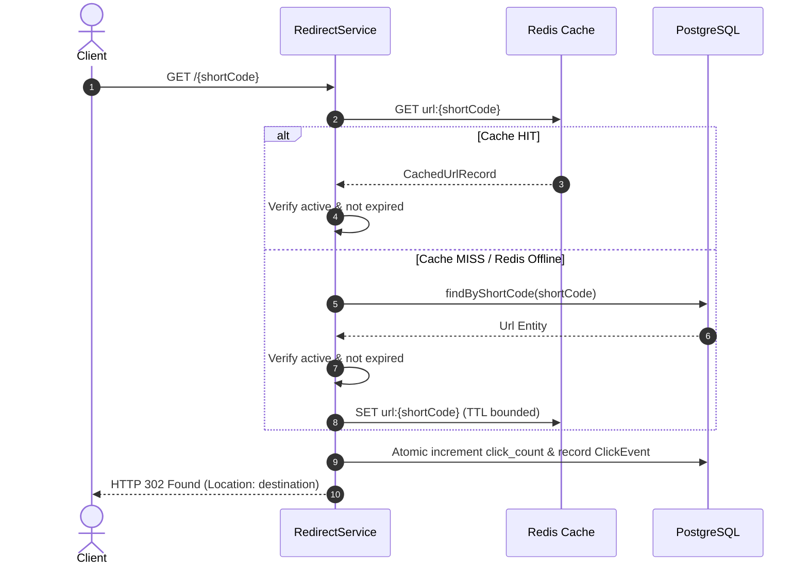

# Enterprise URL Shortener — System Architecture & Design

This document details the architectural decisions, component layers, data modeling, caching strategies, and concurrency considerations of the **Enterprise URL Shortener**.

---

## 1. Guiding Architectural Philosophy: Modular Monolith

Rather than introducing distributed microservice overhead (service discovery, distributed transactions, event brokers, multi-repo CI/CD), the application is built as a **modular monolith** with clean, decoupled package boundaries.

### Layered Structure
```
Client / HTTP Browser
         │
         ▼
┌────────────────────────────────────────────────────────┐
│ Spring Boot Application                                │
│                                                        │
│  ├── Controllers (HTTP mapping, DTO validation)        │
│  ├── Services (Core domain logic, lifecycle rules)     │
│  ├── Repositories (Spring Data JPA persistence)       │
│  ├── Cache Component (Redis cache-aside lookup)        │
│  └── Exception Handling (@RestControllerAdvice)        │
└────────┬───────────────────────────────────────┬───────┘
         │                                       │
         ▼                                       ▼
┌──────────────────┐                   ┌──────────────────┐
│    PostgreSQL    │                   │      Redis       │
│ (Source of Truth)│                   │ (Disposable Read │
│                  │                   │      Cache)      │
└──────────────────┘                   └──────────────────┘
```

### Why Modular Monolith First?
1. **Explainable Trade-offs**: In an engineering review or interview, single-process coordination is easy to reason about, test, profile, and debug.
2. **Transactional Integrity**: Link updates and atomic counter queries leverage PostgreSQL's ACID guarantees directly.
3. **Operational Simplicity**: Can be started with a single `docker compose up` or local JDK runtime.

---

## 2. PostgreSQL as the Authoritative Source of Truth

Redis is strictly a transient optimization cache. PostgreSQL holds the persistent, durable data.

### Schema Design

#### `urls` Table
| Column | Type | Constraints / Description |
|---|---|---|
| `id` | BIGSERIAL | Primary Key |
| `short_code` | VARCHAR(16) | Unique index, case-sensitive |
| `original_url` | TEXT | Not null, validated HTTP/HTTPS URI |
| `created_at` | TIMESTAMPTZ | Not null, UTC instant |
| `expires_at` | TIMESTAMPTZ | Nullable, validated future instant |
| `is_active` | BOOLEAN | Default true |
| `click_count` | BIGINT | Default 0, atomically updated |

#### `click_events` Table
| Column | Type | Constraints / Description |
|---|---|---|
| `id` | BIGSERIAL | Primary Key |
| `url_id` | BIGINT | Foreign key referencing `urls.id` (ON DELETE CASCADE) |
| `clicked_at` | TIMESTAMPTZ | Not null, UTC timestamp |
| `referrer` | TEXT | Nullable, truncated to 1024 characters |
| `user_agent` | TEXT | Nullable, truncated to 512 characters |

### Concurrency & The Atomic Click Counter
A common rookie mistake is doing a Java read-modify-write (`url.setClickCount(url.getClickCount() + 1)`). Under concurrent traffic, multiple threads read the same counter value, resulting in lost updates.

We resolve this by using a direct database atomic query:
```sql
UPDATE urls SET click_count = click_count + 1 WHERE id = :urlId
```
This leverages PostgreSQL row-level locks, guaranteeing zero lost increments even under high concurrent redirect spikes.

---

## 3. Redis Cache-Aside & Lifecycle Invalidation

### Cache-Aside Sequence


### Critical Correctness Guarantees
1. **Expiry & Inactivity Enforcement on Cache Hits**:
   Caching a URL cannot bypass business lifecycle rules. Even on a Redis cache hit, `RedirectService` checks `cached.isExpired()` and `cached.active()`. If expired or inactive, it returns HTTP 410 Gone immediately.
2. **Bounded TTL**:
   The TTL in Redis is bounded by the URL's expiry date:
   $$\text{Effective TTL} = \min(\text{Default TTL (1800s)}, \text{Remaining Seconds Until Expiry})$$
   Already expired URLs are never written to cache.
3. **Cache Eviction on Mutation**:
   Whenever a link is updated via `PATCH` or deleted via `DELETE`, `UrlCacheService.evict(shortCode)` is invoked immediately after the database transaction succeeds.
4. **Graceful Redis Degradation**:
   If Redis becomes unreachable (network split, container crash), the application catches Redis connection exceptions, logs a warning, and falls back to PostgreSQL seamlessly without dropping redirect requests.

---

## 4. Short-Code Generation & Bounded Collision Handling

- **Alphabet**: URL-safe Base62 character set `[0-9a-zA-Z]` (62 symbols).
- **Code Length**: 7 characters.
- **Key Space**: $62^7 = 3,521,614,606,208$ (approx. 3.52 trillion unique combinations).
- **Entropy**: Cryptographically secure `java.security.SecureRandom`.

### Collision Prevention
A pre-insert `existsByShortCode` check is insufficient under concurrency due to race conditions. The PostgreSQL unique constraint `idx_urls_short_code` is the authoritative guard.

When an insert encounters a `DataIntegrityViolationException`, the service retries up to **5 bounded times** with a newly generated code. If retries are exhausted, a controlled `ShortCodeCollisionException` is thrown and mapped to a clean 500 error without exposing database internals.

---

## 5. Analytics Isolation Pattern

Redirect speed is the primary service SLA. If click analytics storage fails (e.g., table lock, transient persistence hiccup), redirecting the user to the destination URL should **still succeed**.

In `RedirectService`:
```java
try {
    analyticsService.recordClick(targetId, referrer, userAgent);
} catch (Exception ex) {
    log.error("Failed to record analytics for URL id {}: {}", targetId, ex.getMessage());
}
```
Analytics errors are isolated and logged without aborting the HTTP 302 redirect.
